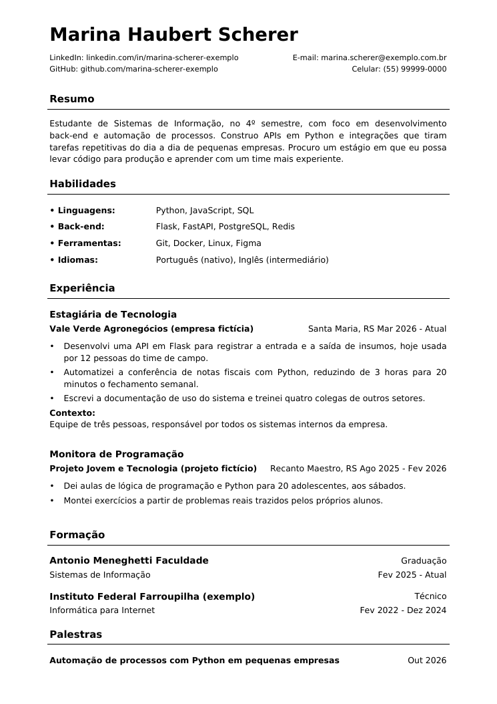

# Gerador de Currículo

App web em que a pessoa preenche um formulário e baixa o currículo em PDF na hora.
Feito para uso em sala de aula: o aluno abre o link, preenche, baixa e já sai com um PDF
limpo e padronizado, sem Word, sem template, sem cadastro.

**Nada é salvo no servidor.** O PDF é montado na memória, enviado para o navegador e descartado.
O rascunho do formulário fica apenas no `localStorage` do navegador do próprio aluno.



---

## Sumário

- [O que ele faz](#o-que-ele-faz)
- [Como rodar](#como-rodar)
- [Exemplo pronto](#exemplo-pronto)
- [Como usar o formulário](#como-usar-o-formulário)
- [API](#api)
- [Campos aceitos](#campos-aceitos)
- [Como o PDF é montado](#como-o-pdf-é-montado)
- [Privacidade e limites](#privacidade-e-limites)
- [Estrutura do projeto](#estrutura-do-projeto)
- [Personalização](#personalização)
- [Deploy](#deploy)
- [Licença e créditos](#licença-e-créditos)

---

## O que ele faz

- Formulário em uma página só, com as seções de um currículo: dados pessoais, resumo,
  habilidades, experiência, formação, palestras, publicações, certificações e voluntariado.
- Itens que podem ser adicionados, removidos e reordenados (setas ↑ ↓).
- Datas escolhidas por mês e ano, com a opção **Atual** para o que ainda está em curso.
  O PDF sempre sai no mesmo formato: `Fev 2025 - Dez 2026` ou `Fev 2025 - Atual`.
- Rascunho salvo automaticamente no navegador: fechar a aba não perde o que foi digitado.
- PDF gerado na hora, com acentuação correta (fontes DejaVu embutidas).
- Seções vazias simplesmente não aparecem no PDF.
- Habilidades da mesma categoria são juntadas numa linha só, sem repetir item.
- Sem banco de dados, sem variáveis de ambiente, sem login.

## Como rodar

### Com Python

```bash
python3 -m venv .venv
source .venv/bin/activate        # no Windows: .venv\Scripts\activate
pip install -r requirements.txt
python app.py
```

Abra <http://localhost:8000>.

O `python app.py` sobe o servidor de desenvolvimento do Flask, com recarregamento automático.
Se a porta 8000 já estiver em uso, rode em outra:

```bash
python -c "import app; app.app.run(port=8080)"
```

### Com Docker

```bash
docker build -t gerador-cv .
docker run --rm -p 8000:8000 gerador-cv
```

A imagem roda com gunicorn (2 workers, 4 threads), como usuário não-root, e tem
`HEALTHCHECK` apontando para `/health`.

## Exemplo pronto

A pasta [`exemplo/`](exemplo/) tem um currículo fictício completo, para você ver o resultado
antes de preencher qualquer coisa:

| Arquivo | O que é |
|---|---|
| [`dados-exemplo.json`](exemplo/dados-exemplo.json) | o JSON que o formulário envia, com todas as seções preenchidas |
| [`CV_Marina_Haubert_Scherer.pdf`](exemplo/CV_Marina_Haubert_Scherer.pdf) | o PDF gerado a partir desse JSON |
| `preview.png` | a imagem da primeira página, usada aqui no README |

Os dados são inventados: pessoa, empresas e projetos não existem.

Para gerar o PDF do exemplo você mesmo, com o servidor rodando:

```bash
curl -X POST http://localhost:8000/gerar \
  -H "Content-Type: application/json" \
  -d @exemplo/dados-exemplo.json \
  -o meu-cv.pdf
```

## Como usar o formulário

1. Preencha **nome** e **e-mail** (os dois únicos campos obrigatórios).
2. Preencha o que fizer sentido nas demais seções. O que ficar em branco não entra no PDF.
3. Em **Habilidades**, escreva a categoria (ex.: `Linguagens`) e os itens separados por
   vírgula ou ponto e vírgula (ex.: `Python, SQL, Git`).
4. Em **Experiência**, cada linha do campo de pontos vira um marcador no PDF. Pode começar
   a linha com `-` ou `•`: o traço é removido automaticamente.
5. Nos **períodos** (experiência, formação e voluntariado), escolha mês e ano de início e de
   término. Se ainda está no cargo, no curso ou na atividade, marque **Atual**: os campos de
   término ficam desativados e o PDF mostra `Fev 2025 - Atual`.
   O mês é opcional — só o ano também vale, e sai `2025 - 2026`.
6. Clique em **Gerar PDF**. O download começa com o nome `CV_Nome_Da_Pessoa.pdf`.

O botão **Limpar** apaga o rascunho salvo no navegador.

## API

São três rotas. Nenhuma exige autenticação.

### `GET /`

Devolve a página do formulário.

### `GET /health`

Checagem usada pelo Docker e por serviços de deploy.

```json
{ "status": "ok" }
```

### `POST /gerar`

Recebe o JSON do currículo e devolve o PDF.

- **Content-Type:** `application/json`
- **Resposta 200:** o arquivo PDF (`application/pdf`), como anexo, com o nome derivado do campo nome.
- **Resposta 400:** `{"erro": "Informe seu nome completo."}` — validação falhou.
- **Resposta 413:** corpo maior que 256 KB.
- **Resposta 500:** falha ao montar o PDF.

Exemplo mínimo:

```bash
curl -X POST http://localhost:8000/gerar \
  -H "Content-Type: application/json" \
  -d '{"pessoal":{"nome":"Fulana de Tal","email":"fulana@exemplo.com"},
       "resumo":"Estudante de Sistemas de Informação."}' \
  -o cv.pdf
```

## Campos aceitos

Tudo que chega do navegador passa por [`schema.py`](schema.py): campos desconhecidos são
ignorados, textos são aparados e truncados, listas têm tamanho máximo e itens vazios somem.

**Dados pessoais** (`pessoal`) — `nome` (80 caracteres, obrigatório), `email` (120, obrigatório,
precisa ter formato de e-mail), `celular` (40), `linkedin` (200), `github` (200).

**Resumo** (`resumo`) — texto de até 1500 caracteres, aceita quebras de linha.

**Seções em lista** — no máximo 15 itens cada. Um item só entra no PDF se o campo obrigatório
dele estiver preenchido:

| Seção | Campos | Obrigatório no item |
|---|---|---|
| `habilidades` | `categoria` (60), `itens` (300) | `itens` |
| `experiencias` | `cargo` (120), `empresa` (120), `local` (120), *período*, `pontos` (1500), `contexto` (1500) | `cargo` ou `empresa` |
| `formacoes` | `instituicao` (120), `grau` (60), `curso` (120), *período* | `instituicao` ou `curso` |
| `palestras` | `titulo` (300), *data*, `descricao` (1500) | `titulo` |
| `publicacoes` | `titulo` (300), *data*, `descricao` (1500) | `titulo` |
| `certificacoes` | `nome` (120), *data* | `nome` |
| `voluntariado` | `funcao` (120), *período*, `descricao` (1500) | `funcao` |

### Datas

Em vez de um texto livre, as datas chegam em partes e são montadas pelo servidor. Isso mantém
o formato igual em todos os currículos.

| Onde | Campos no JSON | Vira |
|---|---|---|
| *período* (experiência, formação, voluntariado) | `inicio_mes`, `inicio_ano`, `fim_mes`, `fim_ano`, `atual` (true/false) | `periodo`: `"Fev 2025 - Dez 2026"`, `"Fev 2025 - Atual"` |
| *data* (palestras, publicações, certificações) | `mes`, `ano` | `periodo` (ou `data`, nas certificações): `"Out 2026"` |

- O mês aceita várias formas: `Fev`, `fevereiro`, `2` ou `02`. O ano aceita `2025` ou `25`.
- `atual: true` ignora o que estiver no término e escreve `Atual`.
- Mês sem ano é descartado; ano sem mês vale sozinho (`"2025 - 2026"`).
- Quem monta o JSON na mão pode continuar mandando o texto pronto em `periodo` (ou `data`):
  ele é usado quando as partes vêm vazias.

### Regras extras aplicadas na validação

- **Habilidades:** categorias iguais (ignorando maiúsculas) viram uma linha só, e habilidades
  repetidas são descartadas. Item sem categoria entra como `Gerais`.
- **Experiência:** o campo `pontos` é quebrado por linha; marcadores (`-`, `•`, `*`, `·`) no
  começo da linha são removidos.
- Caracteres de controle são removidos e três ou mais quebras de linha seguidas viram duas.

## Como o PDF é montado

O layout fica em [`cv_pdf.py`](cv_pdf.py), em cima do [fpdf2](https://py-pdf.github.io/fpdf2/):

- A4, margens de 20 mm nas laterais, quebra automática de página.
- Cabeçalho com o nome em destaque e, abaixo, LinkedIn e e-mail numa linha, GitHub e celular
  na outra.
- Cada seção tem título em negrito com uma linha horizontal abaixo.
- Linhas de duas colunas (ex.: empresa à esquerda, local e período à direita) medem a altura
  antes de desenhar: se não couber, o bloco inteiro vai para a próxima página, em vez de
  cada coluna cair numa página diferente.
- Blocos opcionais vazios (como `Contexto:`) não são impressos.
- As fontes DejaVu ficam em [`fonts/`](fonts/) e são embutidas no PDF, por isso a acentuação
  sai correta em qualquer leitor.

## Privacidade e limites

- Nada é gravado em disco no servidor: o PDF é montado em memória e enviado na resposta.
- Não há banco de dados, cookies de sessão nem rastreamento.
- O rascunho do formulário fica só no `localStorage` do navegador do usuário.
- O corpo da requisição é limitado a 256 KB (`MAX_CONTENT_LENGTH`), o que já é muito mais
  do que um currículo ocupa.
- O container roda como usuário não-root.

Se você publicar o app em um domínio, continue sem coletar dados: é o que torna seguro pedir
que a turma inteira use.

## Estrutura do projeto

```
gerador_cv/
├── app.py              # rotas Flask: página, health e geração do PDF
├── schema.py           # validação e normalização do JSON recebido
├── cv_pdf.py           # layout do PDF (fpdf2)
├── templates/
│   └── index.html      # o formulário
├── static/
│   ├── app.js          # itens dinâmicos, rascunho no localStorage, envio
│   └── style.css       # estilo da página
├── fonts/              # DejaVu Sans (normal e bold), embutidas no PDF
├── exemplo/            # currículo fictício de exemplo (JSON + PDF + imagem)
├── requirements.txt
└── Dockerfile
```

## Personalização

- **Trocar os textos do formulário:** `templates/index.html`.
- **Mudar a aparência da página:** `static/style.css`.
- **Mudar o layout do PDF** (tamanhos, espaçamentos, ordem das seções): `cv_pdf.py`, na função
  `gerar_pdf` e nos métodos `add_*`.
- **Mudar limites de tamanho ou adicionar campo novo:** `schema.py` (constantes `CURTO`,
  `MEDIO`, `LONGO`, `MAX_ITENS` e o dicionário `SECOES`). Um campo novo precisa existir nos
  três lugares: formulário, schema e layout do PDF.
- **Trocar a fonte:** coloque os arquivos `.ttf` em `fonts/` e ajuste `add_font` em `cv_pdf.py`.
  A fonte precisa ter os acentos do português.

## Deploy

### Docker em qualquer lugar

A imagem expõe a porta 8000 e não precisa de variável de ambiente nenhuma:

```bash
docker build -t gerador-cv .
docker run -d --restart unless-stopped -p 8000:8000 --name gerador-cv gerador-cv
```

Coloque um proxy reverso na frente (Nginx, Caddy, Traefik) para terminar o HTTPS.

### Coolify

1. Suba esta pasta para um repositório Git.
2. **New Resource → Application → (seu repositório)**.
3. **Build Pack:** `Dockerfile`.
   Se o repositório tiver outras coisas além desta pasta, defina
   **Base Directory** = `/gerador_cv`.
4. **Ports Exposes:** `8000`.
5. Defina o domínio e faça o deploy.

O `HEALTHCHECK` do container já responde em `/health`.

## Licença e créditos

As fontes em `fonts/` são as **DejaVu Sans**, distribuídas sob a licença própria do projeto
DejaVu (derivada da Bitstream Vera), que permite uso e redistribuição.

O restante do código é livre para usar e adaptar em sala de aula. Se for publicar, inclua um
arquivo `LICENSE` com a licença da sua preferência (MIT é a mais simples para esse caso).

Criado por **Prof. Augusto Gehrke** para a disciplina FOIL *Competência Competitiva no Mundo
de Tecnologia*, do curso de Sistemas de Informação da Antonio Meneghetti Faculdade.
